# Firewall на MikroTik - фільтрація трафіку та NAT

> Курс: Комп'ютерні мережі, L1B | 2-3 курс

> Перевірено на RouterOS 7.24.5 та WinBox 4.4

---

## 1 Схема мережі

> 📁 Зображення схеми: `assets/network-configs_mikrotik-firewall_1.svg`

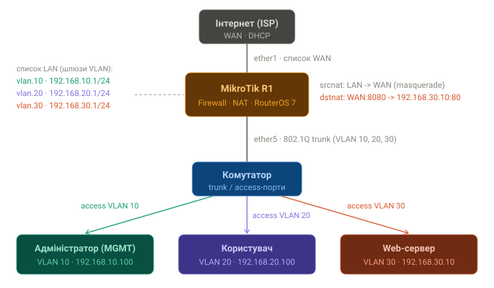

Інструкція є продовженням [VLAN на MikroTik](vlans-mikrotik.md): на маршрутизаторі R1 вже налаштовано VLAN 10, 20, 30 за схемою router-on-a-stick. Додатково порт `ether1` підключено до провайдера (WAN)

| VLAN | Підмережа | Шлюз (R1) | Вузол | Призначення |
|------|-----------|-----------|-------|-------------|
| 10 | 192.168.10.0/24 | 192.168.10.1 | 192.168.10.100 | Адміністрування (MGMT) |
| 20 | 192.168.20.0/24 | 192.168.20.1 | 192.168.20.100 | Користувачі |
| 30 | 192.168.30.0/24 | 192.168.30.1 | 192.168.30.10 | Сервери (Web-сервер) |
| - | адреса від провайдера (DHCP) | - | - | WAN, порт `ether1` |

Якщо WAN ще не налаштовано - отримати адресу від провайдера та (за потреби) увімкнути на R1 DNS-сервер для клієнтів:

```
/ip dhcp-client add interface=ether1
/ip dns set allow-remote-requests=yes
```

### 1.1 Політика безпеки

Що має дозволяти firewall:

| Звідки | Куди | Що дозволено |
|--------|------|--------------|
| VLAN 10 (адміністратори) | маршрутизатор R1 | WinBox (TCP 8291), SSH (TCP 22) |
| усі VLAN | маршрутизатор R1 | ping (ICMP), DNS (порт 53) |
| VLAN 10 | будь-куди | усе |
| VLAN 20 | Web-сервер 192.168.30.10 | тільки HTTP/HTTPS (TCP 80, 443) |
| усі VLAN | Інтернет | усе |
| Інтернет | Web-сервер | TCP 8080 на WAN-адресі R1 → 192.168.30.10:80 |
| **усе інше** | | **заборонено та записується в журнал** |

!!! info "Принцип налаштування"
    Використовується підхід **"дозволити потрібне - заборонити все інше"** (default deny): спочатку правила `accept` для потрібного трафіку, а останнім у кожному ланцюжку - правило `drop` для всього, що не підійшло під жодне правило

---

## 2 Теоретичні відомості

### 2.1 Складові Firewall у RouterOS

Firewall знаходиться в меню **IP → Firewall**. Кожна вкладка - окрема таблиця правил або допоміжний інструмент

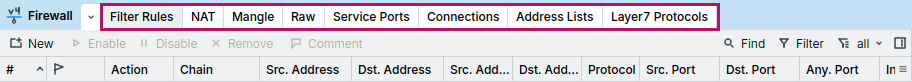

| Вкладка | Призначення |
|---------|-------------|
| **Filter Rules** | Фільтрація: пропустити або відкинути пакет. Основна вкладка цієї інструкції |
| **NAT** | Трансляція адрес: вихід LAN в Інтернет (masquerade), проикдання портів (dst-nat) |
| **Mangle** | Маркування пакетів і з'єднань для маршрутизації та QoS (у цій інструкції не використовується) |
| **Raw** | Обробка пакетів **до** connection tracking - найдешевший спосіб відкинути небажаний трафік |
| **Service Ports** | NAT-помічники для протоколів FTP, SIP, PPTP тощо |
| **Connections** | Таблиця з'єднань, які відстежує маршрутизатор |
| **Address Lists** | Іменовані списки IP-адрес для використання в правилах |
| **Layer7 Protocols** | Пошук шаблонів (regex) у вмісті пакетів - сильно навантажує процесор |

!!! tip "Якщо ви знайомі з iptables"
    Firewall RouterOS побудований за тією ж логікою, що й [iptables](../server-services/iptables.md) у Linux: ланцюжок `input` = `INPUT`, `forward` = `FORWARD`, `output` = `OUTPUT`, `dstnat` = `PREROUTING` таблиці nat, `srcnat` = `POSTROUTING`, а address-list - аналог ipset

### 2.2 Ланцюжки: куди потрапляє пакет

> 📁 Схема: `assets/network-configs_mikrotik-firewall_3.svg`

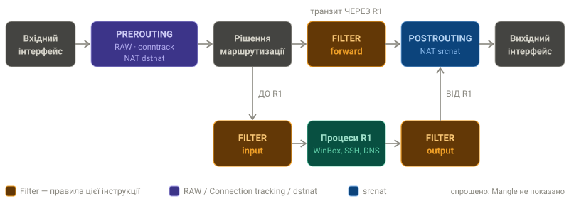

| Ланцюжок | Який трафік обробляє | Приклад |
|----------|----------------------|---------|
| `input` | адресований **самому маршрутизатору** | WinBox, SSH, ping шлюзу, DNS-запит до R1 |
| `forward` | що проходить **через** маршрутизатор | ПК з VLAN 20 → Web-сервер, ПК → Інтернет |
| `output` | створений **самим маршрутизатором** | R1 звертається до DNS провайдера, ping з R1 |

Отже, `input` захищає **сам маршрутизатор**, а `forward` - **мережі за ним**. Ланцюжок `output` у цій інструкції не фільтруємо

### 2.3 Порядок обробки правил

- Правила ланцюжка перевіряються **згори донизу**
- Перше правило з **кінцевою** дією (`accept`, `drop`, `reject`) завершує обробку пакета - нижчі правила вже не перевіряються
- Дії `log`, `add-src-to-address-list`, `passthrough` **не кінцеві**: пакет перевіряється далі
- Якщо пакет не підійшов під жодне правило - **він пропускається**. На відміну від Cisco ACL, у RouterOS немає неявного `deny any` в кінці, тому правило `drop` треба додати самостійно

!!! warning "Порядок має значення"
    Правило `drop`, розміщене вище за правила `accept`, заблокує й потрібний трафік - включно з вашим підключенням WinBox

### 2.4 Стани з'єднань (connection tracking)

Маршрутизатор відстежує кожне з'єднання (вкладка **Connections**) і визначає для кожного пакета його стан:

| Стан | Значення |
|------|----------|
| `new` | перший пакет нового з'єднання (наприклад, TCP SYN) |
| `established` | пакет уже відомого з'єднання, на яке була відповідь |
| `related` | пакет, пов'язаний з наявним з'єднанням (ICMP-помилки, дані FTP) |
| `invalid` | пакет, що не належить жодному відомому з'єднанню або некоректний |
| `untracked` | пакет, для якого відстеження вимкнено в Raw (дія `notrack`) |

Тому достатньо дозволити лише **початок** з'єднання в потрібному напрямку - відповіді пройдуть через правило `established,related`. Такий firewall називають **stateful**

### 2.5 Дії (Action)

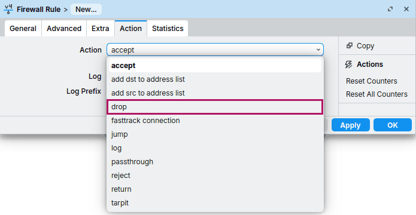

| Дія | Що робить |
|-----|-----------|
| `accept` | пропустити пакет |
| `drop` | мовчки відкинути (відправник не отримує відповіді) |
| `reject` | відкинути та повідомити відправника (ICMP-помилка або TCP RST) |
| `log` | записати пакет у журнал і перевіряти далі |
| `add src/dst to address list` | додати адресу джерела/призначення в address-list і перевіряти далі |
| `jump` / `return` | перейти у власний ланцюжок / повернутися з нього |
| `passthrough` | лише порахувати пакет і перевіряти далі |
| `fasttrack connection` | пропускати пакети з'єднання в обхід firewall (див. розділ 3.9) |
| `tarpit` | "утримувати" TCP-з'єднання атакуючого (захист від сканування) |

!!! tip "drop чи reject?"
    Для трафіку з Інтернету використовуйте `drop` - сканер не дізнається, що порт закритий. `reject` зручніший усередині LAN: клієнт одразу отримує помилку замість очікування тайм-ауту

### 2.6 Особливості WinBox 4

У формах правил WinBox 4 поля умов за замовчуванням приховані:

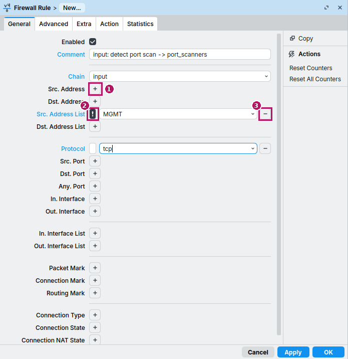

1. **+** - додати умову (поле з'являється у формі)
2. **!** - інвертувати умову (логічне НЕ). На знімку `!MGMT` означає "усі адреси, **крім** списку MGMT"
3. **−** - прибрати умову

Інші корисні елементи:

- **Copy** (права панель вікна правила) - створює копію правила, яку можна змінити
- Порядок правил змінюється **перетягуванням** за маркер `⠿` ліворуч від номера правила
- **Comment** правила показується окремим рядком над ним
- **Safe Mode** - перемикач у верхній панелі WinBox

### 2.7 Interface List та Address List

- **Interface List** - іменований список інтерфейсів (`WAN`, `LAN`). Правила посилаються на список, а не на конкретний інтерфейс: якщо з'явиться новий VLAN, достатньо додати його до списку `LAN` - правила firewall змінювати не потрібно
- **Address List** - іменований список IP-адрес або підмереж. Записи бувають постійні та тимчасові (з `timeout`), їх можна додавати автоматично правилами firewall. Як адресу можна вказати й доменне ім'я - RouterOS сам визначить його IP-адреси

---

## 3 Налаштування MikroTik (RouterOS 7)

### 3.1 Підготовка - Safe Mode

!!! danger "Firewall може заблокувати доступ до самого маршрутизатора"
    Помилка в правилах `input` - і WinBox-сесія обірветься. Підключайтеся до R1 з VLAN 10 (адреса 192.168.10.1) та вмикайте **Safe Mode** перед змінами

Safe Mode вмикається перемикачем у верхній панелі WinBox (у терміналі - `Ctrl+X` або `F4`). Якщо з'єднання обірветься, RouterOS автоматично скасує всі зміни, зроблені в цьому режимі (обрив визначається за TCP-тайм-аутом - до 9 хвилин). Коли все працює - вимкніть Safe Mode, і зміни буде збережено


!!! note "Обмеження Safe Mode"
    Safe Mode пам'ятає до 100 останніх змін. Якщо їх більше - режим вимикається автоматично і зміни **не** відкочуються. Тому вмикайте його для кожного кроку окремо

!!! warning "Заводська конфігурація (defconf)"
    На маршрутизаторах MikroTik із заводськими налаштуваннями вже є списки `WAN`/`LAN` та правила firewall з коментарем `defconf`. Перевірте перед початком: `/ip firewall filter print`. Інструкція розрахована на конфігурацію без заводських правил (як після налаштування з [VLAN на MikroTik](vlans-mikrotik.md))

---

### 3.2 Крок 1 - Створити списки інтерфейсів WAN та LAN

```
/interface list
add name=WAN
add name=LAN

/interface list member
add list=WAN interface=ether1
add list=LAN interface=vlan.10
add list=LAN interface=vlan.20
add list=LAN interface=vlan.30
```

**WinBox:** `Interfaces` → вкладка `Interface List` → `Lists` → `New` → Name = `WAN`. Аналогічно створити список `LAN`

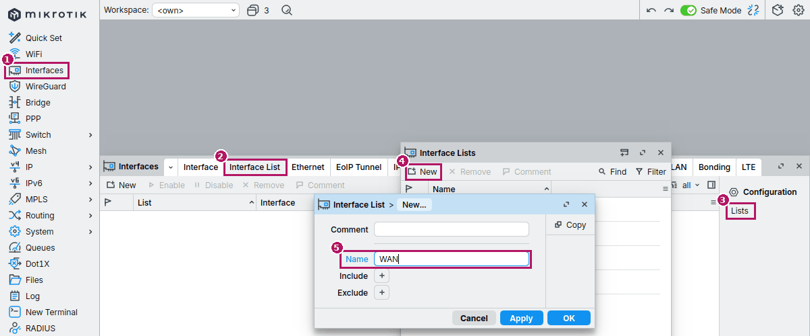

Додати інтерфейси до списків: вкладка `Interface List` → `New` → List = `WAN`, Interface = `ether1`. Аналогічно `vlan.10`, `vlan.20`, `vlan.30` → список `LAN`

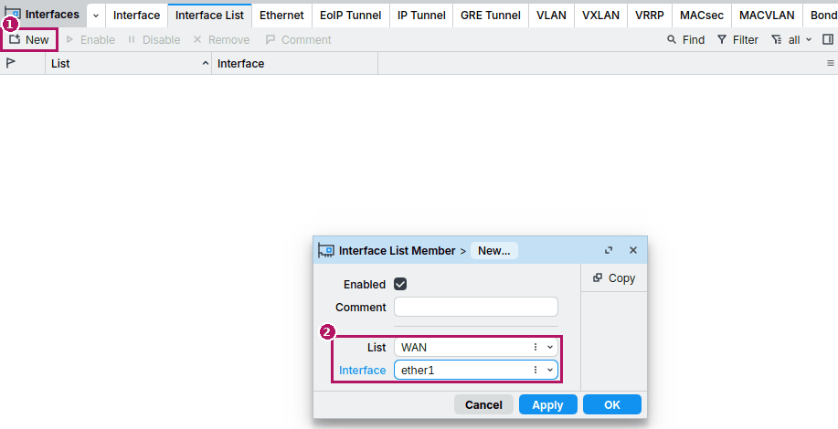

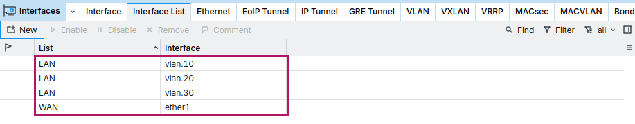

!!! info "Чому vlan.X, а не bridge1 чи ether5"
    Firewall працює на 3 рівні й бачить інтерфейс, на якому знаходиться IP-адреса. Для наших мереж це `vlan.10`, `vlan.20`, `vlan.30` - саме їх видно в журналі як `in:vlan.20`

---

### 3.3 Крок 2 - Створити список адрес адміністраторів MGMT

Цей список використовується для доступу до керування маршрутизатором

```
/ip firewall address-list
add list=MGMT address=192.168.10.0/24 comment="Admin VLAN 10"
```

**WinBox:** `IP` → `Firewall`

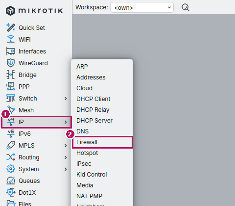

Вкладка `Address Lists` → `New` → List = `MGMT`, Address = `192.168.10.0/24`

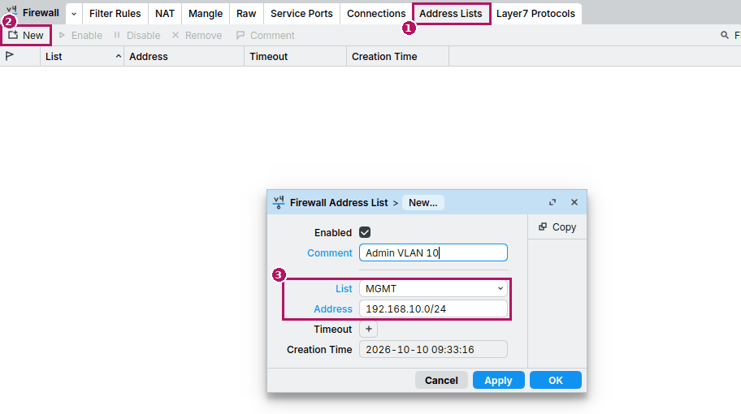

!!! tip "Суворіший варіант"
    Замість усієї підмережі можна додати лише адреси конкретних адміністраторів, наприклад `192.168.10.100/32`

---

### 3.4 Крок 3 - Захист маршрутизатора (ланцюжок input)

| № | Правило | Навіщо |
|---|---------|--------|
| 1 | accept established, related, untracked | пропустити відповіді та вже дозволені з'єднання |
| 2 | drop invalid | відкинути некоректні пакети |
| 3 | accept ICMP | ping та службові ICMP-повідомлення |
| 4 | accept WinBox/SSH з MGMT | керування маршрутизатором лише з VLAN 10 |
| 5-6 | accept DNS з LAN | клієнти використовують R1 як DNS-сервер |
| 7 | drop усе інше + журнал | заборонити все, що не дозволено вище |

```
/ip firewall filter
add chain=input action=accept \
    connection-state=established,related,untracked \
    comment="input: accept established,related,untracked"
add chain=input action=drop connection-state=invalid \
    comment="input: drop invalid"
add chain=input action=accept protocol=icmp \
    comment="input: accept ICMP"
add chain=input action=accept protocol=tcp dst-port=22,8291 \
    src-address-list=MGMT comment="input: accept WinBox/SSH from MGMT"
add chain=input action=accept protocol=udp dst-port=53 in-interface-list=LAN \
    comment="input: accept DNS (udp) from LAN"
add chain=input action=accept protocol=tcp dst-port=53 in-interface-list=LAN \
    comment="input: accept DNS (tcp) from LAN"
add chain=input action=drop log=yes log-prefix="IN-DROP" \
    comment="input: drop all other"
```

!!! tip "Коментарі до правил"
    Підписуйте кожне правило (поле **Comment**): через місяць ніхто не згадає, навіщо потрібне "правило №5". Коментарі також зручно використовувати в командах: `[find comment="..."]`

Далі - те саме у WinBox: `IP` → `Firewall` → вкладка `Filter Rules` → `New`

#### Правило 1 - пропустити встановлені з'єднання

- **General:** Chain = `input`, Connection State (кнопка **+**) = ☑ `established` ☑ `related` ☑ `untracked`
- **Action:** Action = `accept` (значення за замовчуванням)
- **Comment:** `input: accept established,related,untracked`

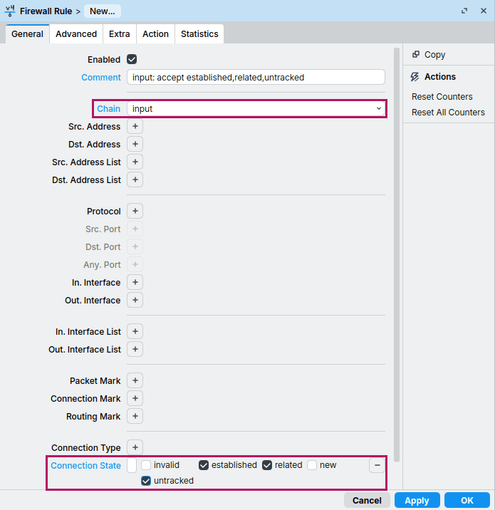

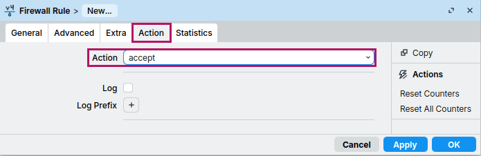

#### Правило 2 - відкинути invalid

- **General:** Chain = `input`, Connection State = ☑ `invalid`
- **Action:** Action = `drop`

#### Правило 3 - дозволити ICMP

- **General:** Chain = `input`, Protocol = `icmp`
- **Action:** `accept`

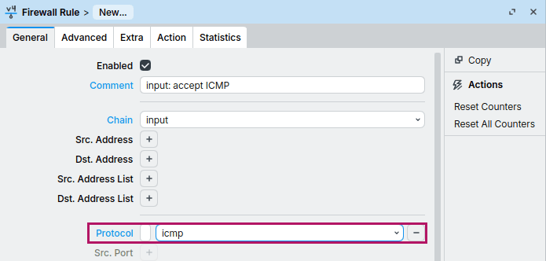

!!! info "Чому не блокувати ping"
    ICMP потрібен не лише для ping: через нього передаються повідомлення про помилки та працює визначення MTU (Path MTU Discovery). Повна заборона ICMP ускладнює діагностику мережі

#### Правило 4 - WinBox та SSH лише з MGMT

- **General:** Chain = `input`, Src. Address List = `MGMT`, Protocol = `tcp`, Dst. Port = `22,8291`
- **Action:** `accept`

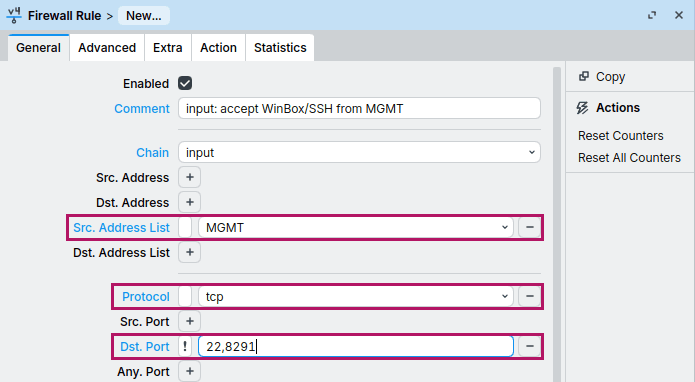

| Порт | Служба |
|------|--------|
| TCP 8291 | WinBox |
| TCP 22 | SSH |
| TCP 80 / 443 | WebFig (додайте, якщо використовується) |

!!! tip "Додатковий рівень захисту"
    Обмежте адреси і в налаштуваннях самих служб: `IP → Services` → поле **Available From** (CLI: `/ip service set winbox address=192.168.10.0/24`). Детальніше - у розділі [Захист пристроїв](basic-dev-sec.md)

#### Правила 5-6 - DNS з LAN

- **General:** Chain = `input`, Protocol = `udp`, Dst. Port = `53`, In. Interface List = `LAN`
- **Action:** `accept`

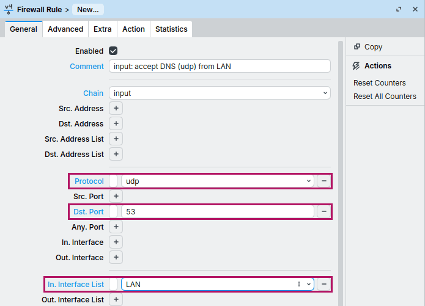

DNS використовує і UDP, і TCP. Друге правило швидше створити копіюванням: відкрийте правило подвійним кліком → **Copy**

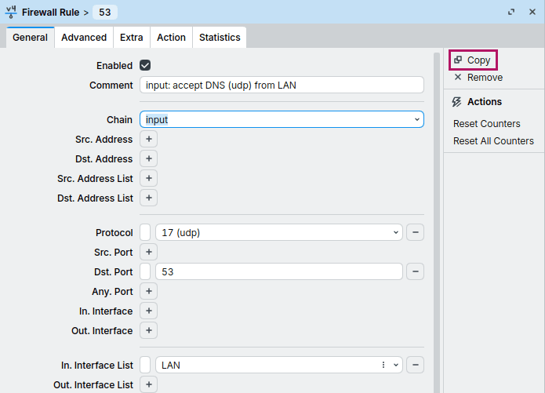

У копії змініть Protocol на `tcp` та коментар → **OK**

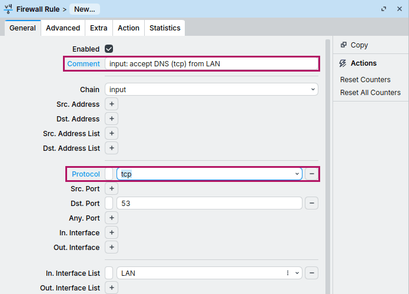

!!! warning "Відкритий DNS-резолвер"
    Якщо на R1 увімкнено `allow-remote-requests=yes`, а firewall не обмежує порт 53, маршрутизатор відповідатиме на DNS-запити з Інтернету. Такі "відкриті резолвери" використовують для DDoS-атак (DNS amplification). Правило 7 закриває цю проблему

#### Правило 7 - заборонити все інше

- **General:** Chain = `input` (інших умов немає - правило підходить для будь-якого пакета)
- **Action:** Action = `drop`, ☑ **Log**, Log Prefix = `IN-DROP`

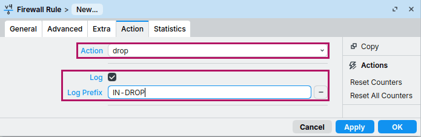

!!! danger "Перевірте перед натисканням OK"
    Правило 4 (WinBox/SSH з MGMT) вже існує, ви підключені з VLAN 10, Safe Mode увімкнено

Результат - ланцюжок `input`:

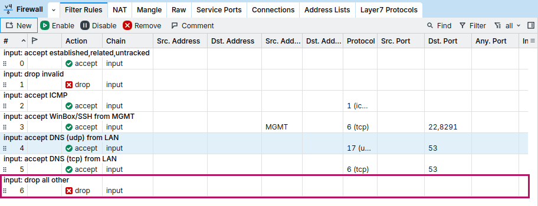

Якщо WinBox-сесія не обірвалася - вимкніть **Safe Mode**, щоб зберегти зміни

!!! info "DHCP-сервер і CAPsMAN"
    DHCP-сервер на R1 працює навіть без окремого дозволу (він отримує пакети в обхід firewall), але запити клієнтів потраплятимуть у журнал з позначкою `IN-DROP`. Щоб не засмічувати журнал, додайте вище правила 7 правило `chain=input protocol=udp dst-port=67 in-interface-list=LAN action=accept`. Якщо на маршрутизаторі працює CAPsMAN, дозвольте також `dst-address=127.0.0.1` (як у заводській конфігурації)

---

### 3.5 Крок 4 - Захист мереж (ланцюжок forward)

| № | Правило | Навіщо |
|---|---------|--------|
| 1 | accept established, related, untracked | пропустити відповіді |
| 2 | drop invalid | відкинути некоректні пакети |
| 3 | accept з `vlan.10` | адміністратори мають доступ до всіх мереж |
| 4 | accept `vlan.20` → 192.168.30.10, TCP 80/443 | користувачі → лише Web-сервер |
| 5 | accept LAN → WAN | доступ до Інтернету для всіх VLAN |
| 6 | accept dstnat з WAN | пропустити проброшені порти (крок 5) |
| 7 | drop усе інше + журнал | усі інші з'єднання між VLAN та з Інтернету заборонені |

```
/ip firewall filter
add chain=forward action=accept \
    connection-state=established,related,untracked \
    comment="forward: accept established,related,untracked"
add chain=forward action=drop connection-state=invalid \
    comment="forward: drop invalid"
add chain=forward action=accept in-interface=vlan.10 \
    comment="forward: accept from Admin VLAN 10"
add chain=forward action=accept in-interface=vlan.20 \
    dst-address=192.168.30.10 protocol=tcp dst-port=80,443 \
    comment="forward: Users -> Web server (HTTP/HTTPS)"
add chain=forward action=accept in-interface-list=LAN out-interface-list=WAN \
    comment="forward: LAN -> Internet"
add chain=forward action=accept in-interface-list=WAN \
    connection-nat-state=dstnat \
    comment="forward: accept port forwarding (dstnat)"
add chain=forward action=drop log=yes log-prefix="FWD-DROP" \
    comment="forward: drop all other"
```

**WinBox:** `IP` → `Firewall` → `Filter Rules` → `New`

Правила 1, 2 та 7 створюються так само, як у ланцюжку `input`, але з Chain = `forward` (для правила 7 - Log Prefix = `FWD-DROP`)

#### Правило 3 - адміністратори мають доступ усюди

- **General:** Chain = `forward`, In. Interface = `vlan.10`
- **Action:** `accept`

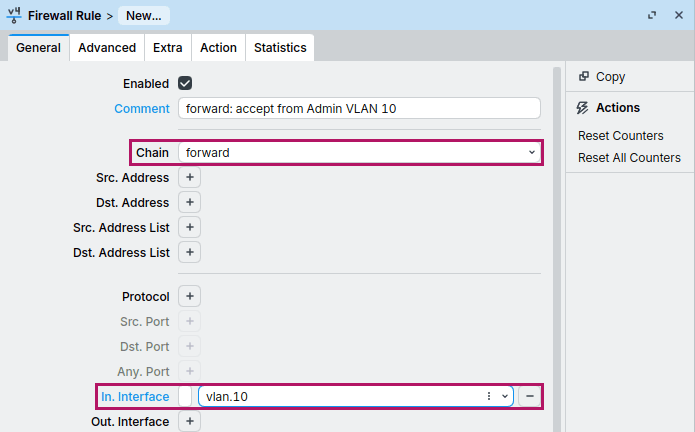

#### Правило 4 - користувачі → Web-сервер

- **General:** Chain = `forward`, Dst. Address = `192.168.30.10`, Protocol = `tcp`, Dst. Port = `80,443`, In. Interface = `vlan.20`
- **Action:** `accept`

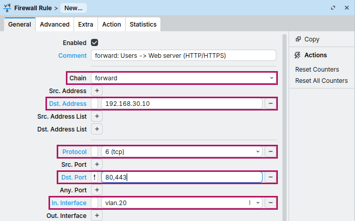

Відповіді сервера пройдуть через правило 1 (`established`), а от **самостійно** звернутися до VLAN 20 сервер не зможе - такі з'єднання відкине правило 7

#### Правило 5 - доступ до Інтернету

- **General:** Chain = `forward`, In. Interface List = `LAN`, Out. Interface List = `WAN`
- **Action:** `accept`

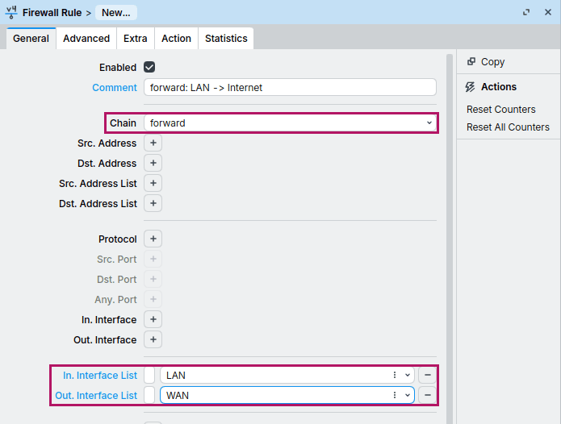

#### Правило 6 - пропустити проброшені порти

- **General:** Chain = `forward`, In. Interface List = `WAN`, Connection NAT State = ☑ `dstnat`
- **Action:** `accept`

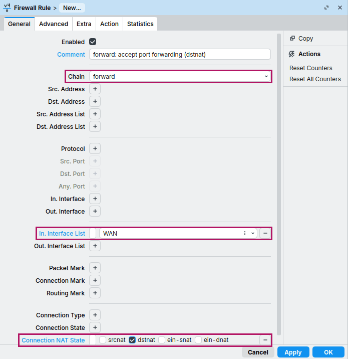

!!! info "Навіщо connection-nat-state=dstnat"
    Правило `dst-nat` (крок 5) змінює адресу призначення ще **до** ланцюжка forward, тому тут пакет уже має адресу `192.168.30.10`, а не WAN-адресу R1. Умова `dstnat` пропускає з Інтернету лише ті з'єднання, для яких явно створено правило прокидання порту. Щоб опублікувати ще один сервіс, достатньо додати правило NAT

Результат - повний список правил Filter:

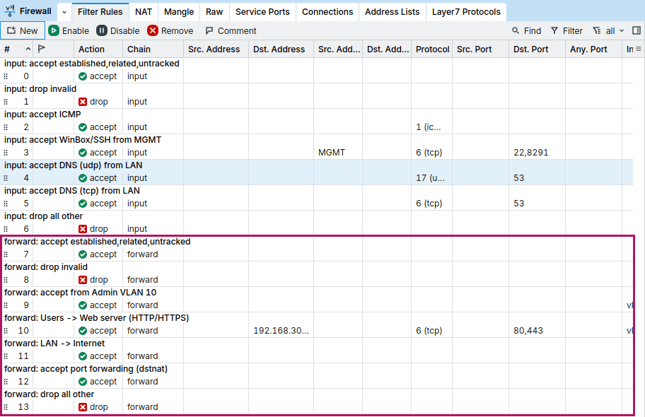

---

### 3.6 Крок 5 - NAT: вихід в Інтернет та прокидання порту

#### 3.6.1 Masquerade - доступ LAN до Інтернету

```
/ip firewall nat
add chain=srcnat action=masquerade out-interface-list=WAN \
    comment="masquerade LAN -> Internet"
```

**WinBox:** `IP` → `Firewall` → вкладка `NAT` → `New`:

- **General:** Chain = `srcnat`, Out. Interface List = `WAN`
- **Action:** Action = `masquerade`

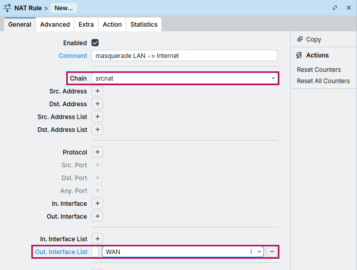

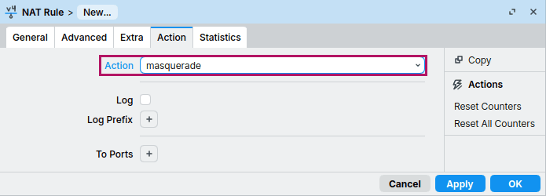

!!! info "masquerade чи src-nat?"
    `masquerade` автоматично підставляє поточну адресу WAN-інтерфейсу - це потрібно, коли адреса динамічна (DHCP, PPPoE). Якщо провайдер видав статичну адресу, використовують `action=src-nat to-addresses=<публічна IP>`

#### 3.6.2 Dst-nat - прокидання порту до Web-сервера

Запити на порт TCP 8080 WAN-адреси R1 передаються на 192.168.30.10:80

```
/ip firewall nat
add chain=dstnat action=dst-nat in-interface-list=WAN \
    protocol=tcp dst-port=8080 to-addresses=192.168.30.10 to-ports=80 \
    comment="port forwarding: WAN:8080 -> Web server:80"
```

**WinBox:** `NAT` → `New`:

- **General:** Chain = `dstnat`, Protocol = `tcp`, Dst. Port = `8080`, In. Interface List = `WAN`
- **Action:** Action = `dst-nat`, To Addresses = `192.168.30.10`, To Ports = `80`

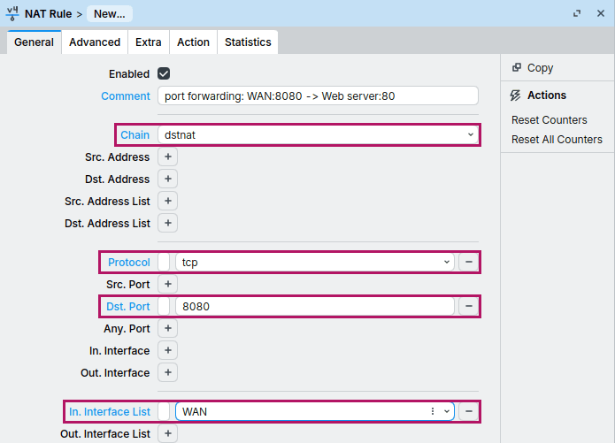

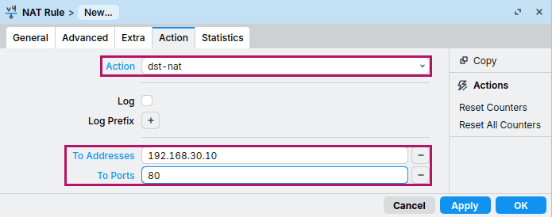

Результат - правила NAT:

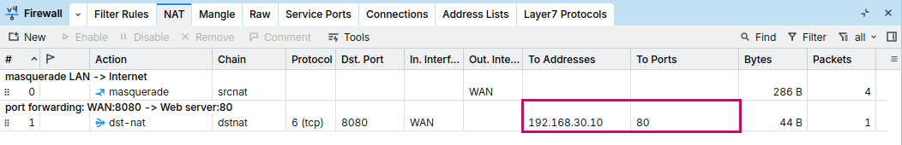

!!! note "Hairpin NAT"
    Клієнти з LAN не зможуть відкрити сервер за **зовнішньою** адресою R1 (порт 8080) - для цього потрібне додаткове правило hairpin NAT. Усередині мережі звертайтеся до сервера напряму: `http://192.168.30.10`

---

### 3.7 Крок 6 - Перевірка

#### 3.7.1 Лічильники правил

Колонки **Bytes** та **Packets** показують, скільки трафіку обробило кожне правило. Правило з нульовим лічильником або не потрібне, або має помилку в умовах, або розміщене нижче за інше правило, яке "перехоплює" його трафік

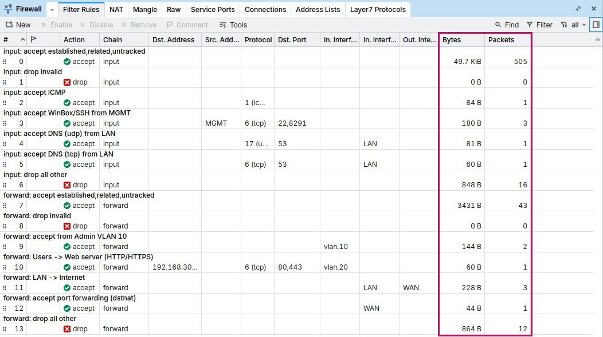

Колонки таблиці налаштовуються кнопкою `≡` праворуч від заголовків. Скинути лічильники - **Reset All Counters** у бічній панелі

#### 3.7.2 Журнал

Правила з ☑ **Log** записують відкинуті пакети в журнал (`Log`) з префіксом `IN-DROP` / `FWD-DROP`:

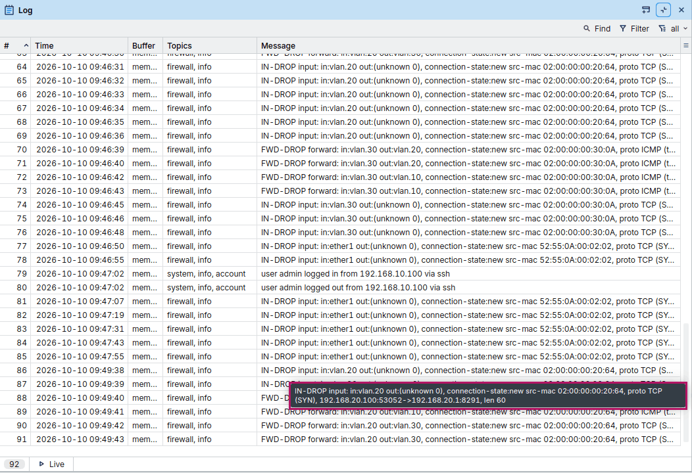

Розбір запису:

```
IN-DROP input: in:vlan.20 out:(unknown 0), connection-state:new
src-mac 02:00:00:00:20:64, proto TCP (SYN),
192.168.20.100:53052->192.168.20.1:8291, len 60
```

- `IN-DROP` - префікс правила, `input` - ланцюжок
- `in:vlan.20` - вхідний інтерфейс (з якого VLAN прийшов пакет)
- `connection-state:new` - спроба нового з'єднання
- `192.168.20.100:53052->192.168.20.1:8291` - ПК з VLAN 20 намагався підключитися до WinBox маршрутизатора

#### 3.7.3 Таблиця з'єднань

Вкладка `Connections` показує з'єднання, які відстежує маршрутизатор:

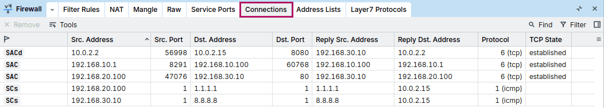

| Прапорець | Значення |
|-----------|----------|
| `S` | seen reply - на з'єднання була відповідь |
| `A` | assured - з'єднання підтверджене (трафік в обидва боки) |
| `C` | confirmed - з'єднання записане в таблицю |
| `s` | srcnat - до з'єднання застосовано srcnat (masquerade) |
| `d` | dstnat - до з'єднання застосовано dstnat (прокидання порту) |

#### 3.7.4 Перевірка політики з вузлів

| Звідки | Перевірка | Очікуваний результат |
|--------|-----------|----------------------|
| ПК VLAN 20 | `ping 192.168.20.1` | ✅ відповідь (ICMP дозволено) |
| ПК VLAN 20 | `ping 192.168.10.100` | ❌ немає відповіді |
| ПК VLAN 20 | `curl http://192.168.30.10` | ✅ сторінка Web-сервера |
| ПК VLAN 20 | `nc -zv 192.168.30.10 22` | ❌ тайм-аут |
| ПК VLAN 20 | WinBox або `nc -zv 192.168.20.1 8291` | ❌ тайм-аут |
| ПК VLAN 20 | `nslookup mikrotik.com 192.168.20.1` | ✅ DNS відповідає |
| ПК VLAN 20 | `ping 1.1.1.1` | ✅ Інтернет працює |
| ПК VLAN 10 | `ping 192.168.20.100`, `nc -zv 192.168.30.10 22` | ✅ адміністратор має доступ усюди |
| ПК VLAN 10 | WinBox на 192.168.10.1 | ✅ |
| Сервер VLAN 30 | `ping 192.168.20.100` | ❌ |
| Сервер VLAN 30 | `ping 1.1.1.1` | ✅ |
| Вузол в Інтернеті | `curl http://<WAN-адреса R1>:8080` | ✅ сторінка Web-сервера |
| Вузол в Інтернеті | WinBox на WAN-адресу R1 | ❌ |

!!! tip "Чим перевіряти"
    VPCS у PNET Lab має обмежений набір команд (`ping`, `trace`). Для перевірки HTTP, DNS та TCP-портів зручніше використовувати вузли з Linux (`curl`, `nc`, `nslookup`). Після кожної перевірки дивіться, який лічильник збільшився і що з'явилося в журналі

---

### 3.8 Додатково - захист від сканування портів (PSD + Raw)

PSD (Port Scan Detection) виявляє сканування: кожен TCP-пакет на новий порт має "вагу". Якщо пакети від однієї адреси на різні порти йдуть з паузою не більше `Delay Threshold`, а їх сумарна вага досягає `Weight Threshold`, ця адреса вважається сканером

| Параметр | Значення | Пояснення |
|----------|----------|-----------|
| Weight Threshold | 21 | поріг сумарної ваги |
| Delay Threshold | 3 с | максимальна пауза між пакетами однієї серії сканування |
| Low Port Weight | 3 | вага порту < 1024 (7 таких портів = 21) |
| High Port Weight | 1 | вага порту ≥ 1024 (21 такий порт = 21) |

Сканер потрапляє в список `port_scanners` на добу, а правило в **Raw** відкидає весь його трафік ще до connection tracking

```
/ip firewall filter
add chain=input action=add-src-to-address-list protocol=tcp \
    psd=21,3s,3,1 src-address-list=!MGMT \
    address-list=port_scanners address-list-timeout=1d \
    comment="input: detect port scan -> port_scanners" \
    place-before=[find comment="input: drop all other"]

/ip firewall raw
add chain=prerouting action=drop src-address-list=port_scanners \
    comment="raw: drop port scanners"
```

**WinBox:** `Filter Rules` → `New`:

- **General:** Chain = `input`, Src. Address List = `MGMT` з інверсією **!** (адміністраторів не блокуємо), Protocol = `tcp`

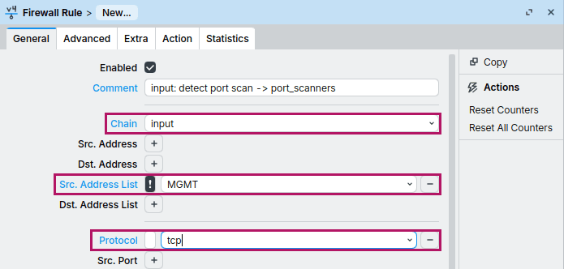

- **Extra:** розгорнути **PSD** і задати параметри

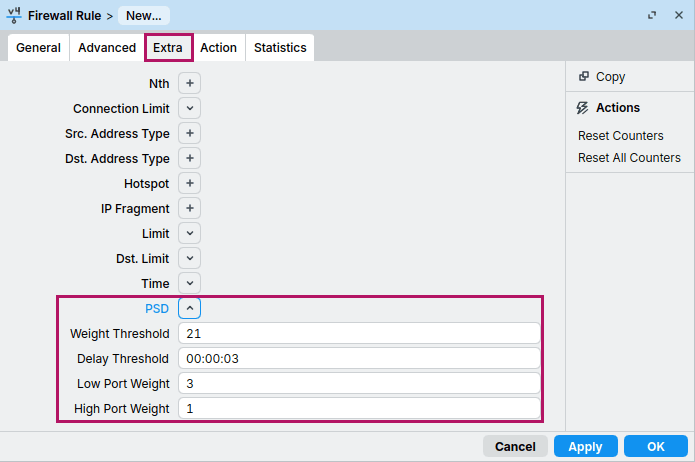

- **Action:** Action = `add src to address list`, Address List = `port_scanners`, Timeout = `1d 00:00:00`

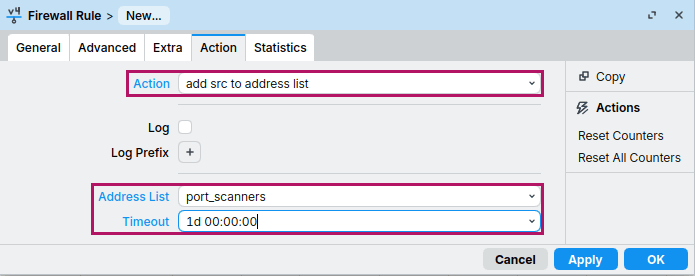

Нове правило з'являється в кінці списку. Перетягніть його за маркер `⠿` **вище** правила `input: drop all other` - інакше пакети будуть відкинуті раніше, ніж PSD їх проаналізує

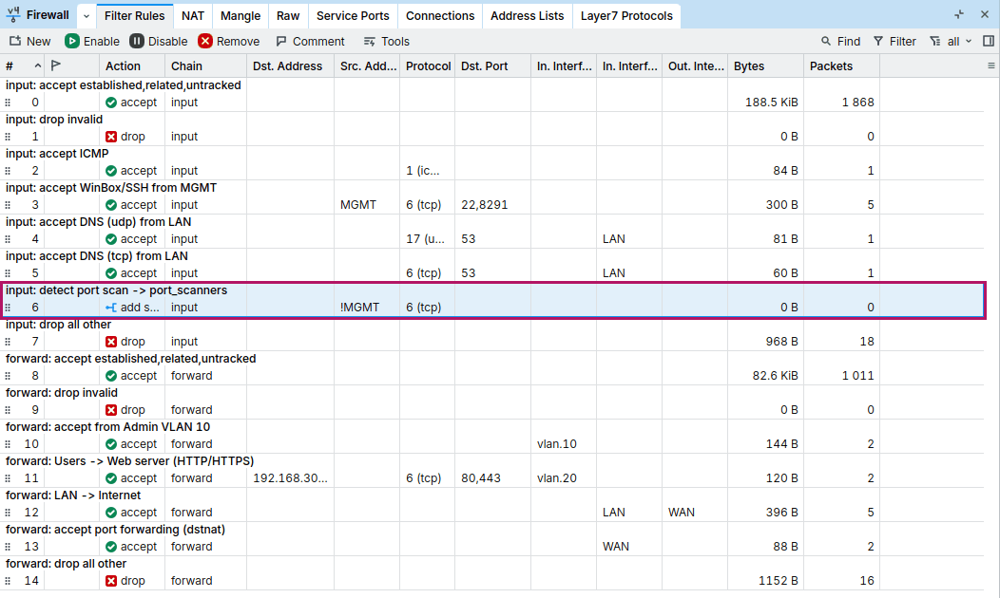

Правило в Raw: `IP` → `Firewall` → вкладка `Raw` → `New`:

- **General:** Chain = `prerouting`, Src. Address List = `port_scanners`
- **Action:** `drop`

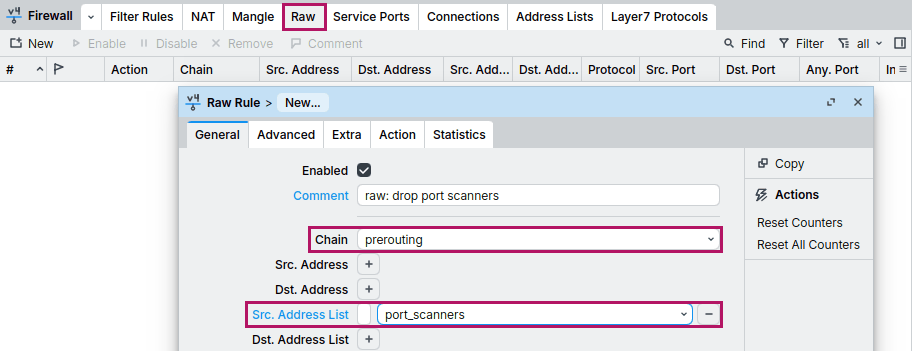

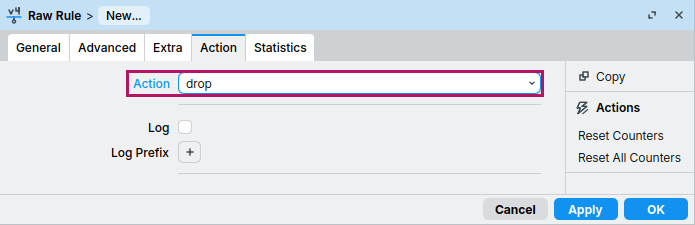

Перевірка: після сканування з ПК VLAN 20 (`nmap 192.168.20.1`) його адреса з'являється у списку з тайм-аутом, і весь трафік з неї відкидається - навіть ping

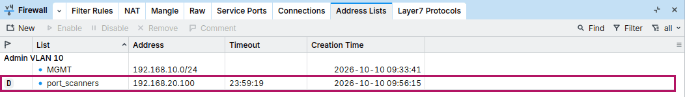

```
# Розблокувати адресу вручну
/ip firewall address-list remove \
    [find list=port_scanners address=192.168.20.100]
```

!!! info "Чому Raw"
    Raw обробляє пакети до connection tracking, тому відкидання там найменше навантажує процесор - це важливо під час сканування чи DoS-атаки

---

### 3.9 Додатково - FastTrack

FastTrack пропускає пакети вже встановлених з'єднань в обхід більшої частини firewall, що значно знижує навантаження на процесор. Правило ставиться **першим** у ланцюжку forward:

```
/ip firewall filter
add chain=forward action=fasttrack-connection \
    connection-state=established,related comment="forward: fasttrack" \
    place-before=[find comment="forward: accept established,related,untracked"]
```

!!! warning "Обмеження FastTrack"
    - Пакети FastTrack-з'єднань не проходять через Mangle, Queues та більшість правил firewall - не вмикайте його разом із Simple Queues (обмеження швидкості) та політиками IPsec без додаткових винятків
    - Після додавання з'являється динамічне правило `special dummy rule to show fasttrack counters` - це нормально
    - На пристроях з апаратним прискоренням маршрутизації (L3 HW offload) правило може мати ще параметр `hw-offload=yes`. На CHR і пристроях без такої підтримки цей параметр недоступний

---

### 3.10 Додатково - доступ на рівні L2 та IPv6

!!! danger "MAC-WinBox обходить IP firewall"
    WinBox уміє підключатися за MAC-адресою (вкладка Neighbors) - це трафік 2 рівня, і правила `IP → Firewall` його **не фільтрують**. Обмежте MAC-доступ та виявлення сусідів:

    ```
    /tool mac-server set allowed-interface-list=LAN
    /tool mac-server mac-winbox set allowed-interface-list=LAN
    /ip neighbor discovery-settings set discover-interface-list=LAN
    ```

    Ще краще - створити окремий список інтерфейсів лише з `vlan.10`. Детальніше - у розділі [Захист пристроїв](basic-dev-sec.md)

!!! warning "IPv6 потребує окремого firewall"
    Правила `/ip firewall` діють лише для IPv4. Якщо IPv6 не використовується - вимкніть його: `/ipv6 settings set disable-ipv6=yes`. Якщо використовується - налаштуйте аналогічні правила в `/ipv6 firewall filter`

---

### 3.11 Повна конфігурація (CLI)

??? example "Повний скрипт налаштування firewall (натисніть, щоб розгорнути)"

    ```
    # ===== Списки інтерфейсів =====
    /interface list
    add name=WAN
    add name=LAN
    /interface list member
    add list=WAN interface=ether1
    add list=LAN interface=vlan.10
    add list=LAN interface=vlan.20
    add list=LAN interface=vlan.30

    # ===== Список адрес адміністраторів =====
    /ip firewall address-list
    add list=MGMT address=192.168.10.0/24 comment="Admin VLAN 10"

    # ===== Захист маршрутизатора (input) =====
    /ip firewall filter
    add chain=input action=accept \
        connection-state=established,related,untracked \
        comment="input: accept established,related,untracked"
    add chain=input action=drop connection-state=invalid \
        comment="input: drop invalid"
    add chain=input action=accept protocol=icmp \
        comment="input: accept ICMP"
    add chain=input action=accept protocol=tcp dst-port=22,8291 \
        src-address-list=MGMT comment="input: accept WinBox/SSH from MGMT"
    add chain=input action=accept protocol=udp dst-port=53 in-interface-list=LAN \
        comment="input: accept DNS (udp) from LAN"
    add chain=input action=accept protocol=tcp dst-port=53 in-interface-list=LAN \
        comment="input: accept DNS (tcp) from LAN"
    add chain=input action=add-src-to-address-list protocol=tcp \
        psd=21,3s,3,1 src-address-list=!MGMT \
        address-list=port_scanners address-list-timeout=1d \
        comment="input: detect port scan -> port_scanners"
    add chain=input action=drop log=yes log-prefix="IN-DROP" \
        comment="input: drop all other"

    # ===== Захист мереж (forward) =====
    add chain=forward action=accept \
        connection-state=established,related,untracked \
        comment="forward: accept established,related,untracked"
    add chain=forward action=drop connection-state=invalid \
        comment="forward: drop invalid"
    add chain=forward action=accept in-interface=vlan.10 \
        comment="forward: accept from Admin VLAN 10"
    add chain=forward action=accept in-interface=vlan.20 \
        dst-address=192.168.30.10 protocol=tcp dst-port=80,443 \
        comment="forward: Users -> Web server (HTTP/HTTPS)"
    add chain=forward action=accept in-interface-list=LAN out-interface-list=WAN \
        comment="forward: LAN -> Internet"
    add chain=forward action=accept in-interface-list=WAN \
        connection-nat-state=dstnat \
        comment="forward: accept port forwarding (dstnat)"
    add chain=forward action=drop log=yes log-prefix="FWD-DROP" \
        comment="forward: drop all other"

    # ===== NAT =====
    /ip firewall nat
    add chain=srcnat action=masquerade out-interface-list=WAN \
        comment="masquerade LAN -> Internet"
    add chain=dstnat action=dst-nat in-interface-list=WAN \
        protocol=tcp dst-port=8080 to-addresses=192.168.30.10 to-ports=80 \
        comment="port forwarding: WAN:8080 -> Web server:80"

    # ===== Raw: відкидати трафік сканерів портів =====
    /ip firewall raw
    add chain=prerouting action=drop src-address-list=port_scanners \
        comment="raw: drop port scanners"
    ```

Скрипт можна вставити в термінал (`New Terminal` у WinBox) або завантажити файлом `firewall.rsc` у `Files` і виконати `/import file-name=firewall.rsc`

---

## 4 Типові помилки

| Симптом | Причина | Рішення |
|---------|---------|---------|
| Після додавання правила обірвався WinBox | `drop` у `input` стоїть вище за правило для MGMT або підключення не з VLAN 10 | Safe Mode відкотить зміни. Без нього - підключитися через консоль або MAC-WinBox і виправити порядок |
| Не відкриваються сайти, хоча доступ дозволено | немає правила `established,related` - блокуються відповіді | додати правило 1 у `forward` та `input` |
| Лічильник правила дорівнює 0 | вище стоїть правило, яке "перехоплює" трафік, або помилка в умовах | перевірити порядок і умови, переглянути журнал |
| Прокидання порту не працює | у forward немає правила `dstnat` або в NAT вказано не той порт/інтерфейс | перевірити правило 6 кроку 4 і правило dst-nat |
| Прокидання порту не працює зсередини LAN | потрібен hairpin NAT | звертатися до сервера за внутрішньою адресою |
| Новий VLAN не має доступу до Інтернету | інтерфейс не додано до списку `LAN` | `/interface list member add list=LAN interface=vlan.40` |
| `failure: already have interface list with such name` | список уже існує (заводська конфігурація) | використати наявний список, перевірити його склад |

---

## 5 Корисні команди

```
# Правила з лічильниками
/ip firewall filter print stats
/ip firewall nat print stats

# Детально - лише правила ланцюжка input
/ip firewall filter print detail where chain=input

# Скинути лічильники
/ip firewall filter reset-counters-all

# Записи журналу firewall
/log print where topics~"firewall"

# Активні з'єднання
/ip firewall connection print

# Тимчасово вимкнути / увімкнути правило
/ip firewall filter disable [find comment="forward: drop all other"]
/ip firewall filter enable [find comment="forward: drop all other"]

# Перемістити правило вище за інше
/ip firewall filter move \
    [find comment="input: detect port scan -> port_scanners"] \
    destination=[find comment="input: drop all other"]
```

---

> 📌 **Зберегти резервну копію MikroTik:** `System → Backup` або через CLI: `/system backup save`

> 📌 **Експортувати правила firewall у текстовий файл:** `/ip firewall export file=firewall`

---

!!! quote "Джерело"
    Стаття базується на офіційній документації MikroTik:

    - [Filter](https://help.mikrotik.com/docs/spaces/ROS/pages/48660574/Filter)
    - [NAT](https://help.mikrotik.com/docs/spaces/ROS/pages/3211299/NAT)
    - [Connection tracking](https://help.mikrotik.com/docs/spaces/ROS/pages/130220087/Connection+tracking)
    - [Packet Flow in RouterOS](https://help.mikrotik.com/docs/spaces/ROS/pages/328227/Packet+Flow+in+RouterOS)
    - [Address-lists](https://help.mikrotik.com/docs/spaces/ROS/pages/130220135/Address-lists)
    - [Interface Lists](https://help.mikrotik.com/docs/spaces/ROS/pages/47579180/Interface+Lists)
    - [Building Advanced Firewall](https://help.mikrotik.com/docs/spaces/ROS/pages/328513/Building+Advanced+Firewall)
    - [Configuration Management (Safe Mode)](https://help.mikrotik.com/docs/spaces/ROS/pages/328155/Configuration+Management)
